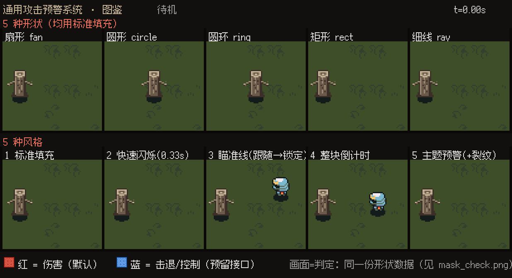
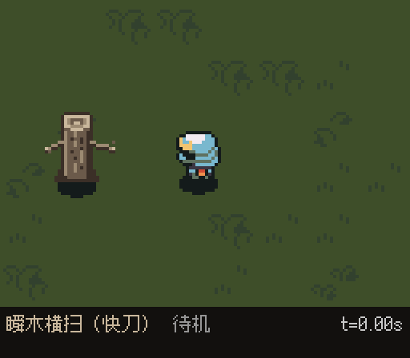
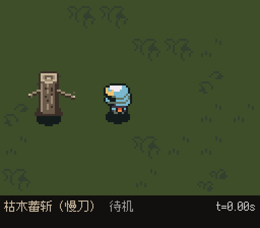
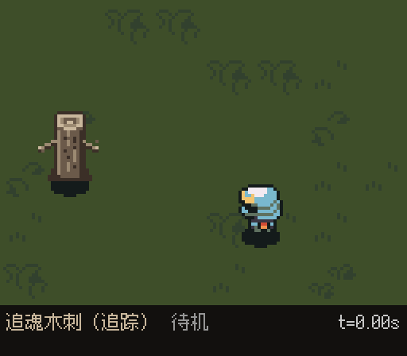
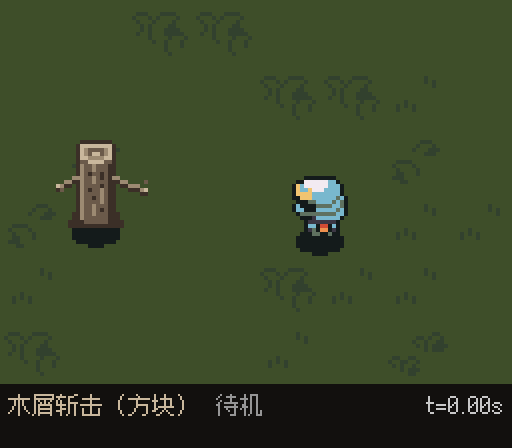
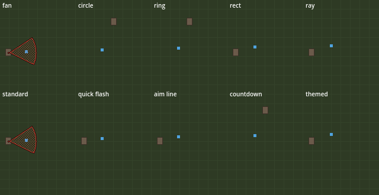
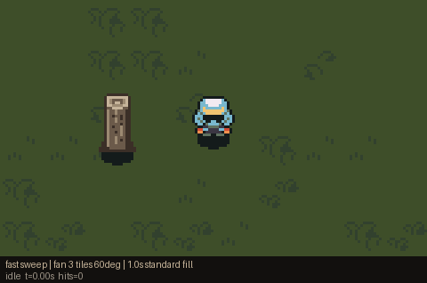

# pixel-attack-telegraph

**An Agent Skill + Godot 4 toolkit for fair, reusable attack warnings in 2D pixel-art games.**

[中文说明](README.zh-CN.md)

Give it to your coding agent (Codex, Claude Code, Cursor, ...) in any game project. The agent will
read your enemies' attacks, **recommend** a warning shape / style / timing for each one, **ask you**
to customize the numbers (including a custom shape if the 5 defaults are not enough, and a
DAMAGE / CONTROL / MIXED category with customisable colours), then implement them with the bundled
Godot system - where the drawn warning and the hitbox come from the same data, so players only get
hit where they were warned.



## What's inside

| Path | What |
|---|---|
| `SKILL.md` | the agent workflow (recommend -> ask -> spec -> implement -> verify -> preview) |
| `godot/addons/pixel_telegraph/` | Godot 4 scripts: `PixelTelegraphSpec`, `PixelTelegraph`, overlays, `PixelAttackBudget`, `PixelAttackCadence` |
| `godot/demo/`, `godot/tests/` | runnable demo (5 shapes x 5 styles) and headless tests |
| `tools/` | Python tools: `recommend_telegraph.py` (first-pass recommendation), `render_preview.py` (GIF previews), `telegraph_lib.py` (reference geometry) |
| `references/` | design guide with sources, full parameter reference, cadence & attack-budget guide |
| `examples/` | worked example: a wooden training dummy with 4 attacks (JSON + GIFs) |
| `assets/ninja-adventure/` | three tiny CC0 images used by the preview tool |

## Install

Copy the whole folder where your agent looks for skills, for example:

- **Codex**: `~/.codex/skills/pixel-attack-telegraph/` (or `.codex/skills/` / `.agents/skills/` inside the project)
- **Claude Code**: `~/.claude/skills/pixel-attack-telegraph/` or `<project>/.claude/skills/pixel-attack-telegraph/`
- **Cursor / other agents**: put it in the project (e.g. `tools/pixel-attack-telegraph/`) and tell the agent
  "Read tools/pixel-attack-telegraph/SKILL.md and follow it".

Then ask, e.g.: *"Use the pixel-attack-telegraph skill to design warnings for the slime boss's attacks."*

## Quick start (without an agent)

Godot (4.4+; tested on 4.7.2):

```bash
cd godot
godot --headless --path . --import
godot --headless --path . -s res://tests/run_tests.gd   # exit code 0 = all tests pass
godot --path .                                           # run the demo
```

Use it in your game: copy `godot/addons/pixel_telegraph/` into your project, then

```gdscript
var spec: PixelTelegraphSpec = preload("res://attacks/slam.tres")
var tel := PixelTelegraph.new()
world.add_child(tel)
tel.hit.connect(func():
    if tel.contains_point(player.global_position):
        player.take_hit(spec.damage))
tel.start(spec, enemy, player)
```

Preview GIFs (Python 3.9+):

```bash
pip install -r tools/requirements.txt
python tools/recommend_telegraph.py examples/attacks_input_example.json -o my_spec.json
python tools/render_preview.py my_spec.json -o previews/
python tools/render_preview.py examples/wooden_dummy.json -o previews/
```

## Example: wooden training dummy

| Fast sweep - fan 3 tiles 60 deg, 1.0 s, standard fill | Heavy chop - fan 3 tiles 120 deg, 1.5 s, themed (cracks) |
|---|---|
|  |  |
| **Homing thorn - ray 6 tiles, 1.0 s aim line, tracks 0.6 s then locks** | **Square drop - 2x2 tiles at the player's feet, 1.0 s countdown** |
|  |  |

(Labels in these GIFs are Chinese; the attack names are just example names.)
Rhythm for this example: random gap 1.0-3.0 s (25/50/25 short/mid/long), shared budget of 3 attacks,
never the same attack twice in a row. Pixel check (`examples/wooden_dummy/mask_check.png`): every
drawn warning pixel is inside the hitbox and the hit frame covers it exactly.

Godot demo capture and preview-tool output:




## Parameters

| Parameter | Values | Meaning |
|---|---|---|
| shape | fan / circle / ring / rect / ray (**defaults**) or **custom** | hit area. Custom: tile mask, polygon, and/or union of default shapes (e.g. a 2x2 square `["##","##"]`, or a plus `[".#.","###",".@."]`). |
| radius, inner_radius, angle | px, px, deg | fan / circle / ring size |
| length, width | px | rect / ray size |
| tile_mask, tile_size, tile_anchor, custom_polygon, custom_union | — | custom shape data (same data is the hitbox) |
| anchor | caster / target | from the enemy, or dropped at the target's feet (snapped once) |
| direction | deg or null | fixed facing, or face the target |
| duration | s | warning start -> hit |
| track_time | s | follow the target, then lock |
| style | standard / quick / aim / countdown / themed | how the warning is drawn |
| fill_mode | outward_from_caster / outward_from_shape_center / none | fill direction (auto by style) |
| category | damage / control / mixed / support | gameplay kind; picks the default colour when color_role is auto |
| color_role | auto / damage / control / custom | auto follows category. Defaults: red = damage, blue = control (reserved, unused by the example), purple = mixed, teal = support. Override per category or per skill. |

Full reference: [references/parameters.md](references/parameters.md).

## Design principles

- The 5 built-in shapes are defaults; custom tile masks, polygons and unions are supported.
- The warning **is** the hitbox (same pixel set, checked once on the hit frame).
- Colours follow the attack category (red = damage; blue = control is reserved and unused by the wooden-dummy example). You can override them.
- Show where immediately (outline), show when with fill progress, flash near the end.
- Not colour-only: dark outer + light inner outline on any floor.
- Fast attacks narrow, slow attacks wide; heavy attacks leave a recovery window.
- Random-but-controlled gaps after recovery, plus a shared attack budget.

See [references/design-guide.md](references/design-guide.md) and
[references/cadence-and-budget.md](references/cadence-and-budget.md).

## License

Code and docs: [MIT](LICENSE). Bundled art: Ninja Adventure by Pixel-boy & AAA, CC0 - see [CREDITS.md](CREDITS.md).
