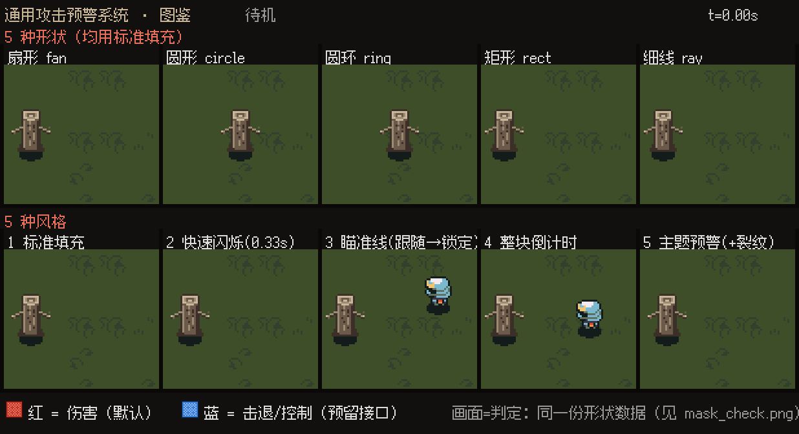
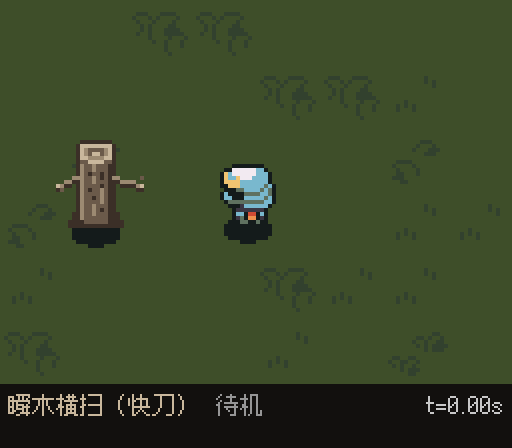
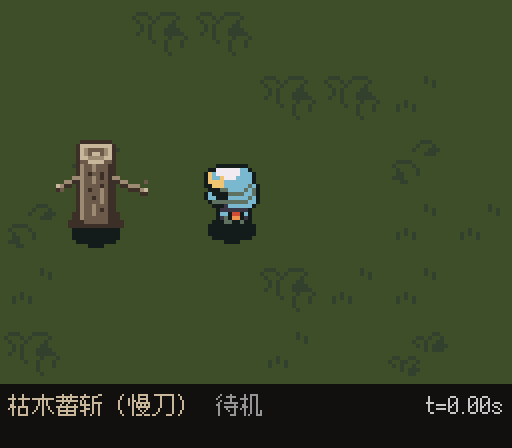
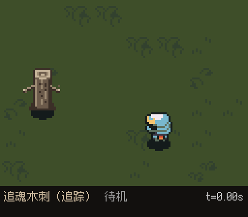
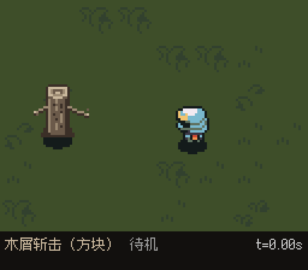

# pixel-attack-telegraph · 像素攻击预警

**一个给 AI 编程助手用的 Skill，加上一套 Godot 4 工具，帮 2D 像素游戏做公平、可复用的攻击预警。**

[English](README.md)

把它放进任何游戏项目，交给 Codex、Claude Code、Cursor 这类编程助手。助手会先读你的怪物有哪些招式，
给每一招**推荐**预警的形状、风格和时长，再**问你**要不要改数值，最后用自带的 Godot 代码实现。
预警画面和伤害判定用同一份数据，所以玩家只会在看到红区的地方挨打。



## 包里有什么

| 路径 | 内容 |
|---|---|
| `SKILL.md` | 助手的工作流程：推荐 → 询问 → 写规范 → 实现 → 校验 → 预览 |
| `godot/addons/pixel_telegraph/` | Godot 4 脚本：预警参数、预警节点、主题叠加层、攻击名额、出招节奏 |
| `godot/demo/`、`godot/tests/` | 可运行的演示场景和自动测试 |
| `tools/` | Python 工具：推荐预警 `recommend_telegraph.py`、生成预览 GIF `render_preview.py` |
| `references/` | 设计指南（附来源）、参数说明、出招节奏与攻击名额指南（英文） |
| `examples/` | 完整示例：木头人的 4 招（参数 JSON + GIF） |
| `assets/ninja-adventure/` | 预览工具用的 3 张 CC0 小图 |

## 安装

把整个文件夹复制到助手读取 skill 的位置，例如：

- **Codex**：`~/.codex/skills/pixel-attack-telegraph/`，或者项目里的 `.codex/skills/`、`.agents/skills/`
- **Claude Code**：`~/.claude/skills/pixel-attack-telegraph/` 或 `<项目>/.claude/skills/pixel-attack-telegraph/`
- **Cursor 或其他助手**：放进项目里（比如 `tools/pixel-attack-telegraph/`），然后对助手说“读一下 tools/pixel-attack-telegraph/SKILL.md 并照着做”

然后直接说，比如：“用 pixel-attack-telegraph 这个 skill，给史莱姆 Boss 的招式设计预警。”

## 快速上手（不用助手）

Godot（4.4 以上，已在 4.7.2 测试）：

```bash
cd godot
godot --headless --path . --import
godot --headless --path . -s res://tests/run_tests.gd   # 返回 0 表示测试全部通过
godot --path .                                           # 运行演示
```

生成预览 GIF（Python 3.9 以上）：

```bash
pip install -r tools/requirements.txt
python tools/recommend_telegraph.py examples/attacks_input_example.json -o my_spec.json
python tools/render_preview.py my_spec.json -o previews/
```

## 示例：木头人四招

| 瞬木横扫：扇形 3 格 60°，预警 1 秒，标准填充 | 枯木蓄斩：扇形 3 格 120°，预警 1.5 秒，填充加裂纹 |
|---|---|
|  |  |
| **追魂木刺：细线 6 格，预警 1 秒，前 0.6 秒跟着转，后 0.4 秒锁定** | **木屑斩击：2×2 格落在玩家脚下，预警 1 秒，从中心往外填** |
|  |  |

这个示例的节奏：每次间隔 1–3 秒随机（短、中、长三档，比例 25%、50%、25%），全场最多同时 3 招，同一招不连出两次。

## 主要参数

| 参数 | 取值 | 含义 |
|---|---|---|
| shape 形状 | 扇形 / 圆形 / 圆环 / 矩形 / 细线 | 打到哪里 |
| radius、inner_radius、angle | 像素、像素、度 | 扇形、圆、圆环的大小 |
| length、width | 像素 | 矩形、细线的长宽 |
| anchor 原点 | 怪物 / 目标脚下 | 从怪物身上打出，或者落在玩家脚下（出招时定位一次） |
| duration 预警时长 | 秒 | 从出招到受伤 |
| track_time 追踪时间 | 秒 | 先跟着玩家转，再锁定 |
| style 风格 | 标准填充 / 快速闪烁 / 瞄准线 / 整块倒计时 / 主题预警 | 预警怎么画 |
| fill_mode 填充方式 | 从怪物往外 / 从图形中心往外 / 不填充 | 默认按风格自动选 |
| color_role 颜色 | 伤害红 / 控制蓝 / 自定义 | 颜色代表什么 |

完整说明见 [references/parameters.md](references/parameters.md)。

## 设计原则

- 预警就是判定：同一份像素数据，只在命中那一帧判定一次。
- 一出招就画出完整范围，用填充进度表示还剩多久，快结束时闪烁。
- 不只靠颜色：深色外描边加浅色内描边，在什么地面上都看得清。
- 快招窄、慢招宽；重招之后留出反击窗口。
- 出招间隔可控地随机，从收招结束后才开始算，再加上全场共用的攻击名额。

## 许可

代码和文档：[MIT](LICENSE)。自带素材：Ninja Adventure（作者 Pixel-boy 和 AAA），CC0，见 [CREDITS.md](CREDITS.md)。
